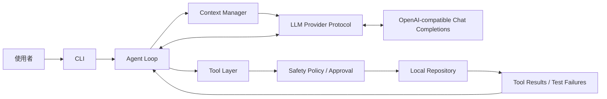

# VanceCode — Mini Coding Agent Harness

**狀態：MVP 0.1.0，真實模型驗收待完成。** 這是學習與展示 coding agent harness 的小型實作。離線測試證明工具、迴圈與評測機制能運作；尚未提供真實模型自主修復的成功率。驗收紀錄與收尾條件見 [MVP_STATUS.md](MVP_STATUS.md)。

從零實作的 Python CLI coding agent。已完成 Milestone 1、Milestone 2 的 Context Manager 第一版，以及 Milestone 3 的 Evaluation Harness 第一版；無第三方 runtime dependencies，Python 3.11+（目前在 Python 3.14 驗證）。



Provider 不直接存取 repository。Loop 維護完整對話與 tool_call_id，Context Manager 產生預算內的對話投影，把工具結果回送給模型；模型根據結果決定下一步。完成條件是：模型停止呼叫工具，且最後一次修改後的測試已通過。失敗測試、工具參數錯誤、拒絕操作都會回送模型；步數到達或壓縮後仍無法容納必要內容則停止並回報未完成。

## 快速開始

在本專案目錄執行，無需安裝即可使用：

```sh
python3 -m vancecode --help
python3 -m unittest discover -s tests -v
python3 scripts/offline_demo.py
```

離線 demo 將故障範例複製到暫存目錄，再經由真正的 Agent Loop 與工具執行：讀檔 → 測試失敗 → 錯誤修改 → 再失敗 → 正確修改 → 四個測試通過。ScriptedProvider 的動作是預先編寫的，這驗證 harness、失敗回饋與重試，不代表 LLM 能自主修復。

若需要 `vancecode` 指令，可選擇在虛擬環境安裝：

```sh
python3 -m venv .venv
source .venv/bin/activate
python -m pip install -e .
```

## 使用真實模型

```sh
cp .env.example .env
# 在 .env 填入 OPENAI_API_KEY 與 VANCECODE_MODEL
cp -R examples/buggy_repo demo-repo
python3 -m vancecode "讀取規格與測試，修復 pricing 的 bug，直到所有測試通過" --repo demo-repo
```

`.env` 從啟動時的工作目錄載入，現有環境變數優先。model 必須支援 function calling；此版本不硬編碼模型名稱。`VANCECODE_BASE_URL` 可設定為支援同一格式的 HTTPS endpoint，金鑰會傳送到該 endpoint。只有一個實際 provider，透過 `Provider.complete(messages, tools)` Protocol 與 loop 解耦。

預設每次修改與執行測試都詢問確認；對已信任的 repository 可使用 `--yes` 讓模型連續執行。`--max-steps 20` 限制模型回合數，每回合最多八個工具呼叫；`--test-timeout 30` 限制單次測試秒數。`--context-chars 200000` 設定序列化 messages 與 tool schemas 的字元預算；`--tool-result-chars 12000` 設定工具結果節錄門檻。API timeout 60 秒；API 錯誤不會自動重送，避免不透明的重複計費。

Exit codes：0 = tests passed 且模型完成、1 = 超出步數/context 上限、2 = 設定/API 錯誤、130 = 使用者中斷。

## 四個核心工具

| Tool | 輸入 | 行為 |
|---|---|---|
| `read_file` | `path`，選填 `start_line`, `end_line` | 讀取最多 100 KB UTF-8 檔案，可指定從 1 起算、含頭尾的行號範圍 |
| `search_code` | `query` | literal 搜尋；空字串列檔案，最多 100 筆、掃描 5,000 個檔案 |
| `apply_patch` | `path`, `old`, `new` | 精確替換唯一匹配文字；不是 unified diff，不建立新檔案 |
| `run_tests` | 無 | 固定執行 `tests/` 內 unittest；零測試視為失敗 |

此版本選擇 apply_patch 作為編輯工具，避免增加另一套 write_file 寫入介面。模型沒有任意 shell command 工具。`run_tests` 使用固定 Python executable、無 shell、獨立 process group、逾時終止與輸出截斷；不繼承 API key 等環境變數。

Safety 拒絕絕對路徑、`..`、逃出 repo 的 symlink、`.env*`、私鑰副檔名、`.git` 等保護目錄，並禁止透過 patch 改測試檔。這是應用層 policy，**不是作業系統 sandbox**。測試會執行 repo 的 Python 程式，仍具有目前使用者的檔案與網路權限；只應在信任的 repo 執行。測試通過也不能證明程式沒有其他 bug。

每次執行測試都使用全新的 Python bytecode cache prefix，並禁止寫入 bytecode，避免同秒、同大小的檔案修改沿用舊 `.pyc`，造成修復後的測試誤判。

## 專案目錄

```text
vancecode/
  cli.py              CLI、設定、互動式確認
  agent.py            Agent Loop、完成條件、上限
  context.py          對話預算、舊紀錄摘要、工具輸出節錄
  evaluation.py       多案例評測、獨立驗收、JSON 報告
  benchmarks.py       三個故障案例與離線 reference patches
  provider.py         Provider Protocol 與 HTTP adapter
  tools.py            四個工具、測試程序
  safety.py           repo 邊界與權限政策
tests/test_harness.py  工具、安全、API 格式與修復迴圈測試
tests/test_context.py  壓縮完整性、預算與小 context 修復測試
tests/test_evaluation.py  評測隔離、失敗處理、檔案完整性與獨立驗收
examples/buggy_repo/   保留故障的 pricing 範例與四個測試
scripts/offline_demo.py  可重複執行的離線整合 demo
.env.example
pyproject.toml
```

## Context Manager

每次模型呼叫前，Context Manager 會：

1. 固定保留 system instructions 與使用者最初的任務。
2. 將過大的工具結果改為有明確標記的頭尾節錄，保留 `ok`、`passed`、exit code 等狀態。
3. 若仍超出預算，依序移除最舊的對話群組。assistant 的同批 tool calls 與對應結果視為整體，避免孤立的 tool result。
4. 加入確定性的歷史摘要，只記錄工具名稱、路徑與執行狀態。摘要是有損的歷史資料，不代表目前檔案內容；不額外呼叫模型。
5. 保留最新群組。如果任務、schemas 或最新完整群組仍無法容納，回報 `context_limit`，不偷偷丟掉最新失敗回饋。

完整對話仍留在 `RunResult.messages`，壓縮只影響送給 provider 的內容。CLI 每回合顯示 context 字元數、移除群組數與節錄結果數。這些計數代表該次投影，不是累積值。原始歷史仍使用記憶體，尚無磁碟持久化。

字元預算計入 JSON escaping 與 tool schemas，**不是 tokenizer 的精確 token 數**，也不包含 model 名稱等少量 HTTP 欄位或預留模型輸出。請依選用模型設定適當上限；模型專用 token 計量與輸出預算留待後續整合。

當檔案內容被節錄，模型可縮小讀取範圍，例如：

```json
{"path": "pricing.py", "start_line": 3, "end_line": 7}
```

範圍讀取仍受 100 KB 檔案上限限制，目前不處理超大檔案。節錄不是可直接套 patch 的完整原文，需要先重新讀取相關行。

不需 API key 即可驗證小 context 下仍能完成修復：

```sh
python3 scripts/offline_demo.py --context-chars 9000 --tool-result-chars 1500
```

這仍是 scripted provider 的整合測試，會在發生壓縮的情況下完成「失敗 → 修改 → 仍失敗 → 再修改 → 通過」。

## Evaluation Harness

不需 API key 的離線評測：

```sh
python3 -m vancecode.evaluation --repeats 2 --output reports/offline.json
```

包含三個內建、可信任的故障案例：

| Case | 問題 | 測試數 |
|---|---|---|
| `shipping_discount` | 運費不應參與商品折扣 | 4 |
| `normalize_slug` | 去除頭尾空白，將連續空白、tab、換行轉為單一連字號 | 5 |
| `mean_precision` | 平均值保留小數，空輸入應拋出 ValueError | 5 |

離線 provider 使用已知 reference patch，驗證 harness 能完成工具流程；成功率**不代表模型能力**。reference patch 留在 runner 的 Python 模組裡，不寫入待修 repo，也不送給 live provider。

每個案例每次重複均建立全新的暫存 repo，先確認 baseline 失敗，再執行 Agent。完成後比較檔案，只允許指定的 implementation 檔案改變；接著將修復版本放入另一個全新 repo，使用原始測試獨立驗收。可見測試通過後，再建立第三個全新 repo 執行 holdout 驗收。成功必須同時符合 Agent 回報完成、可見測試通過與已設定的 holdout 測試通過。原始故障案例不會被改掉。

Holdout 測試不會放入 Agent 操作的 repo、context 或工具結果；只在 Agent 結束後執行，也不把失敗內容回送給模型。三個案例的額外驗收分別檢查商品/折扣/運費組合、Unicode 空白與標點保留，以及浮點數與更多平均值案例。它們是依既有任務規格增加的邊界測試，不增加未告知模型的新要求。

這是評測資料的分離，不是保密或安全隔離：holdout 原始碼仍在專案的 `benchmarks.py`，本機測試程式仍有使用者權限。此小型 benchmark 不能代表通用程式能力，也不能防止惡意程式偵測評測環境。

選擇特定案例或較小 context：

```sh
python3 -m vancecode.evaluation --case normalize_slug --case mean_precision --output reports/selected.json
python3 -m vancecode.evaluation --context-chars 9000 --output reports/small-context.json
```

設定 `.env` 後，明確使用 `--live` 才會呼叫真實模型並產生 API 費用：

```sh
python3 -m vancecode.evaluation --live --repeats 1 --output reports/live.json
```

評測只執行內建可信任 fixtures，自動允許其修改與測試，不提供任意外部 repo 輸入。每個 case 都建立新的 provider instance，避免跨案例對話污染。安裝專案後也可用 `vancecode-eval` 指令。

JSON 報告包含 mode、model、UTC 時間、執行設定、成功率、每案例原因、步數、耗時、provider 呼叫嘗試數、工具呼叫與錯誤數、Agent 測試次數、context 壓縮回合數，以及變動檔案。baseline 與獨立驗收的測試不計入 Agent 工具次數；耗時包含這些驗證。錯誤案例的完整步數無法取得時使用 `null`，平均步數只計入可取得值的執行，並附 `runs_with_step_count`。不記錄 API key、provider 回應本文或完整對話。

每個案例另附 `candidate_patch`（unified diff），供人工檢查模型最後的程式修改。它只包含內建案例的 implementation 差異；沒有可讀候選檔案時為 `null`。報告在暫存 repo 清除後仍保留差異，且不把驗收結果或差異再回送給 Agent。

報告現在為 `schema_version: 2`、`benchmark_version: "2"`，成功率需與相同 benchmark 版本比較。`visible_tests_passed` 與 `holdout_tests_passed` 分開呈現，`final_tests_passed` 代表所需驗收全部通過。尚未執行的驗收為 `null`，不當成通過；沒有設定 holdout 的自訂案例仍可完成可見測試驗收，但 `holdout_configured` 為 false。可見測試通過而 holdout 失敗時原因為 `holdout_tests_failed`。summary 另列出可見測試通過次數與 holdout 的通過、失敗、跳過次數。

目前未收集 API usage，也沒有價格表：token 數與 `cost_usd` 一律為 `null`，不能解讀為零成本。模型自主修復成功率需使用 `--live` 實際執行後才能評估。JSON 先寫暫存檔再原子替換；指定已存在的報告路徑會覆寫舊報告。Exit codes：0 = 全部成功、1 = 至少一個案例失敗、2 = CLI 設定或報告寫入錯誤、130 = 中斷。

## 驗證與下一階段

基本測試涵蓋：故障重現與二次修復、工具參數錯誤、拒絕修改、路徑越界、秘密檔案、測試唯讀、過期 patch、測試 timeout、空測試、環境變數隔離、假完成、迴圈上限，以及 mock HTTP 格式。故障範例不加入專案自身的測試探索；demo 每次複製後修復，保留原始故障。

Context 測試另涵蓋原始任務保留、完整工具群組、未配對結果拒絕、中文 JSON 字元數、節錄標記、完整歷史不被修改、行號讀檔，以及 9,000 字元預算下的修復整合。Evaluation 測試涵蓋多案例重複、baseline 驗證、獨立驗收拒絕假成功、測試檔竄改、provider 錯誤繼續其他案例、報告原子寫入與參數檢查；另有 stale bytecode 回歸測試。新增測試驗證 holdout 不出現在 Agent repo 與對話、針對可見測試寫死答案的修復會被拒絕，以及沒有 holdout 時不宣稱通過。目前共 40 個測試。

真實 API 呼叫與模型自主選工具的修復能力，必須設定自己的 key/model 後執行上面的命令驗收；離線測試不能替代這項驗證。

後續補上模型專用 token 計量、API usage 與成本計算、檔案選取策略，以及更豐富的評測案例。此版本不加入 UI、FastAPI、資料庫、Docker 或 K8s。

工具呼叫的 wire format 依照 [OpenAI 官方 Function calling 文件](https://developers.openai.com/api/docs/guides/function-calling)；此專案自行實作 loop，未使用 agent framework。
